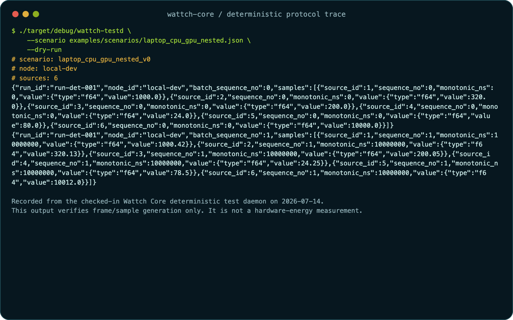
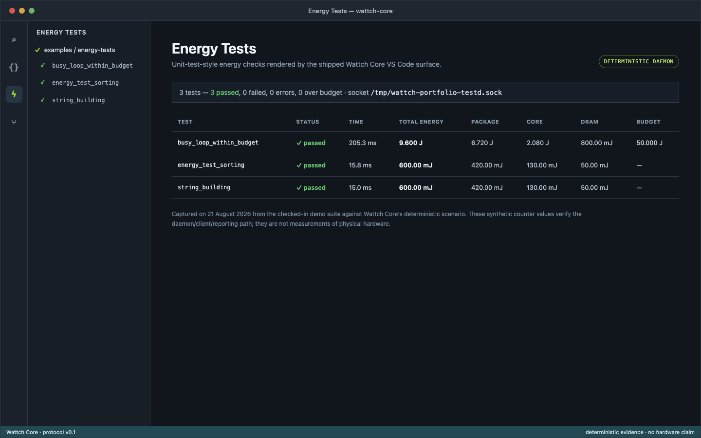
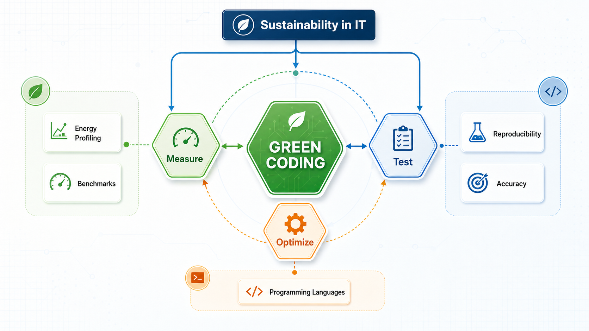

# Chakib Belgaid, PhD

Applied AI engineer (Ph.D.). Lead AI Engineer at [MCQ Scan](https://mcq-scan.com/), building production LLM agent systems, plus developer tools and energy-aware infrastructure.

My work connects product craft with measurable systems: local AI should remain useful without giving up privacy, developer tooling should preserve evidence, and energy claims should be reproducible before they are optimized.

[Portfolio](https://chakib-belgaid.github.io) · [LinkedIn](https://linkedin.com/in/chakib-belgaid) · [Email](mailto:chakib.belgaid@gmail.com)

## Featured work

### [BP Log — bp-tracker](https://github.com/chakib-belgaid/bp-tracker)

A phone web app that reads a blood-pressure monitor’s display from a photo, then lets the user check and correct the values before saving. Image-processing rules handle the display layout; a 10,123-parameter CNN trained on synthetic digits runs in plain JavaScript with a 54 KB weights file.

Published evaluation: 91% complete readings on 55 photos from one monitor; 99.5% digit accuracy on 187 held-out digits. The full reading set guided pipeline development, so it is not an independent holdout. Median phone latency: 268 ms across three runs on an Android 10 phone.

Readings stay in browser storage; no cloud OCR or account. Includes history, CSV/JSON export, and a review-before-save workflow.

`JavaScript` · `Python / PyTorch` · `Synthetic training data` · `Offline inference` · `Evaluation`

### [Whispbook](https://github.com/chakib-belgaid/whispbook)

A self-hosted React/FastAPI studio for importing and editing documents, assigning character voices, previewing local TTS, and exporting chapter audio, subtitles, and M4B audiobooks. Supports Kokoro, Chatterbox, and Chatterbox Turbo; an exported Python script preserves edits and synthesis settings.

The current web app does not wire a separate model-based speaker-annotation provider. The [Qwen3-4B LoRA speaker-attribution experiment](https://huggingface.co/chakibmed/whispbook-qwen3-4b-speaker-lora-speaker_lora_v1_easy_evidence_only_cleaned) is separate from the shipped studio workflow.

`Python` · `FastAPI` · `React` · `TypeScript` · `Local TTS` · `Docker`

### [Whisperbook](https://github.com/chakib-belgaid/whisper-book)

An offline-first Android app that turns local EPUB and PDF books into synchronized, multi-voice audiobooks. Import, chapter detection, speaker attribution, Supertonic 3 synthesis, Media3 playback, read-along state, voice casting, and MP3 export all stay on the device; the runtime deliberately has no network permission.

<table>
  <tr>
    <td align="center" width="33%">
       
      <strong>Now playing</strong> Progressive local narration with the active speaker in view.
    </td>
    <td align="center" width="33%">
       
      <strong>Read along</strong> Synchronized passages with manual speaker correction.
    </td>
    <td align="center" width="33%">
       
      <strong>Voice cast</strong> Previewable voices and language settings per book.
    </td>
  </tr>
</table>

These are API 36 captures of the production Compose UI using deterministic QA data. [Read the case study](https://chakib-belgaid.github.io/work/whispbook) · [Download the latest Android release](https://github.com/chakib-belgaid/whisper-book/releases/latest)

`Kotlin` · `Jetpack Compose` · `Room` · `WorkManager` · `Media3` · `Supertonic 3` · `sherpa-onnx`

### [Wattch Core](https://github.com/chakib-belgaid/wattch-core)

A protocol-first measurement spine for reproducible energy and system-telemetry workflows. I designed the architecture and validation approach and developed the Rust implementation with AI coding assistance. A privileged daemon acquires raw Linux RAPL or synthetic evidence, while unprivileged CLI, Python, and VS Code clients preserve source descriptors and samples in replayable artifacts. Interpretation stays outside the acquisition path. The Python client includes a pyJoules-compatible API and a pyinstrument-based profiler whose time-share attribution is labeled as an estimate, not direct per-process energy measurement.

<table>
  <tr>
    <td align="center" width="50%">
       
      <strong>Deterministic protocol trace</strong> Frame and sample generation through the checked-in scenario.
    </td>
    <td align="center" width="50%">
       
      <strong>Energy Tests</strong> Unit-test-style time, energy-domain, and budget results in VS Code.
    </td>
  </tr>
</table>

The captures above use deterministic/synthetic values to verify the daemon, client, and reporting workflow. They are not physical-hardware measurements or per-process energy claims. [Read the case study](https://chakib-belgaid.github.io/work/wattch)

`Rust` · `Linux RAPL` · `Unix sockets` · `Python` · `pyJoules API` · `VS Code` · `Replayable traces`

## Recent projects and experiments

Updated October 2026. Project implementation languages are distinct from my level of expertise in each language.

### [AgentDiet](https://chakib-belgaid.github.io/work/mcq-scan/#agentdiet)

**Professional work · demonstrator and funded proposal**

I conceived an agent-governance project at MCQ Scan: signed Biscuit tokens, attenuated delegations, and local Datalog checks for tool permissions. I built a Python/FastAPI demonstrator and prepared the technical proposal, market analysis, budget, and project plan. AgentDiet received a 2026 Hyper Open X grant funded by France 2030.

The demonstrator validates simulated authorizations; MCP/A2A integration is the project target.

### [Store Chat](https://chakib-belgaid.github.io/work/mcq-scan/#store-chat)

**Professional work · structured-output evaluation**

A clothing-shopping assistant with Llama 3.1 8B LoRA, local vLLM inference, and Pydantic business validation. I evaluated constrained-decoding tools and integrated LM Format Enforcer to enforce enum values. Internal evaluation separates 97% structurally valid, enum-compliant requests from 95% semantic accuracy per attribute.

These are internal evaluation results, not a public benchmark. My contribution was tool evaluation and integration, not a custom sampler.

### Z-Image-Turbo · Android

**Personal experiment · mobile diffusion inference**

Porting image generation to Nothing Phone 3: 512×512 output, a comparison of 100 runtime/precision configurations, INT8/INT4 quantization, and a QNN w8a16 path on the Hexagon NPU. The work includes numerical checks, activation-saturation diagnosis, and calibration across all diffusion steps.

Experimental work described in my October dossier. Single-block timings do not establish an end-to-end generation speedup; no public repository is linked here.

### [Pocket TTS Android Benchmark](https://github.com/chakib-belgaid/pocket-tts-android-benchmark)

**Public benchmark · OnePlus 6T**

A pinned English INT8 Pocket TTS conversion running through sherpa-onnx on Android. On a OnePlus 6T with Android 11, CPU and two threads, the recorded real-time factors are 0.94, 1.01, and 1.06 for 2, 4, and 8 diffusion steps. Audio samples and machine-readable measurements are published.

One observed run per setting; not averages or a Whisperbook benchmark. RTF is generation time divided by audio duration.

### [Speculative decoding · MLX](https://github.com/chakib-belgaid/speculative-decoding-mlx)

**Public experiment · negative result documented**

Compared Qwen3 4B with a Qwen3 0.6B draft model on 40 labeled speaker-classification samples. Both paths reached 97.5% accuracy, but speculative decoding was 28.3% slower in the recorded protocol.

Short outputs and model loading inside each timed call limit the conclusion. This is not a steady-state serving benchmark.

## Experience and engineering practice

At Inria, on an ANR project with Qarnot Computing as the industrial partner, I contributed to deploying PowerAPI on Qarnot’s infrastructure and reduced its binary size by roughly 300×.

I co-founded a serious-games advertising startup, led six employees and two interns, and delivered two Unity games after winning Ooredoo T-Start in 2014. Our 2016 national campaign attracted more than 300,000 unique subscriber numbers.

I lead a two-person technical team under the CTO, across multi-agent workflows, APIs, interfaces, and deployment. A dependency graph, smaller-model routing, and caching reduced end-to-end workflow processing time by 60% in internal measurements.

Python is my strongest language. I build APIs and AI workflows with FastAPI, Django, Pydantic, React, and TypeScript, and deliver with Docker, GitHub Actions, and GCP.

My inference experience includes local vLLM, MLX on Apple Silicon, LoRA, quantization, and calibration. I distinguish that experimental work from specialist operation of GPU LLM servers in production.

I use AI coding assistants regularly and review and validate their output. Wattch’s Rust implementation was developed with AI assistance; my Rust skill is reading and understanding code, not Python-level fluency.

## Other selected work

- **[Fractal Brushes](https://github.com/chakib-belgaid/fractal-brushes)** — generative fractal and symmetry backgrounds. [Live demo](https://chakib-belgaid.github.io/fractal-brushes/)
- **[jreferral](https://github.com/chakib-belgaid/jreferral)** — recommends energy-efficient JVM configurations for Java software.
- **[IJoules](https://github.com/chakib-belgaid/IJoules)** — measures energy consumption of Python code on macOS / Intel CPU.

## Research foundation

My PhD work focused on energy-aware software engineering: measurement, benchmarking, testing, optimization, language/runtime behavior, and reproducibility. Wattch Core carries that foundation into developer infrastructure with an explicit acquisition boundary, typed evidence, deterministic validation, and replayable traces.

- **[chakib_belgaid_thesis](https://github.com/chakib-belgaid/chakib_belgaid_thesis)** — thesis source and materials.

Source: [thesisBrainMap.svg](assets/thesisBrainMap.svg) · [thesisBrainMap.drawio](assets/thesisBrainMap.drawio)

## Engineering taste

- Measurable before optimized.
- Local-first when possible.
- Explicit about uncertainty and overhead.
- Useful to developers, not only impressive in demos.
